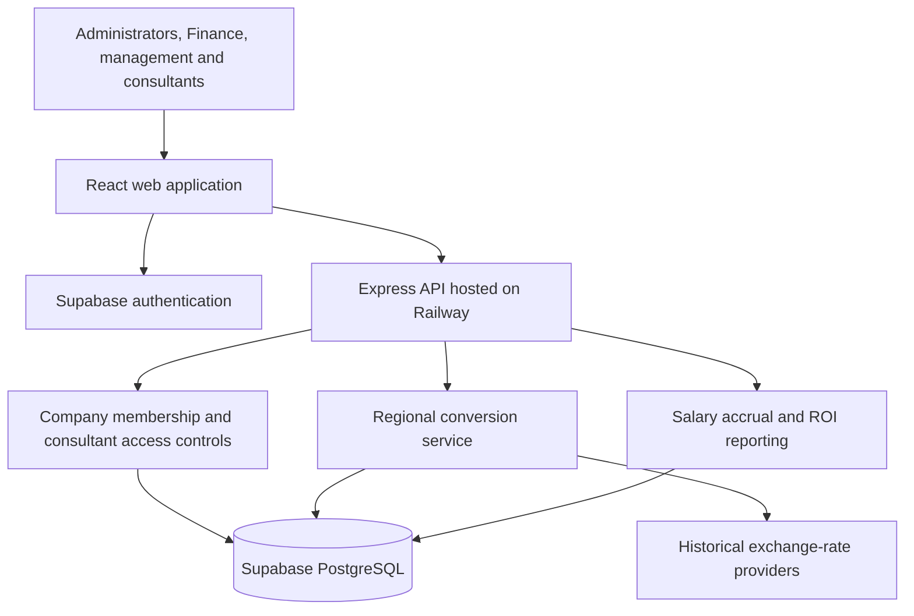

# Splitflow: Product and System Architecture

Updated: 26 October 2026

## 1. Product purpose

Splitflow helps sales agencies understand the financial contribution of their consultants and regional teams. It brings revenue, salaries and operating expenses into a shared workspace so that management can assess performance, Finance can allocate costs to countries, and headquarters can review consolidated results in the company's home currency.

The product answers three core questions:

- **Individual performance:** What does each consultant generate in revenue compared with the cost of employing and supporting them?
- **Country performance:** How do revenue and costs compare across the countries in which the agency operates?
- **Company performance:** What is the combined financial contribution of those operations in a single reporting currency?

The intended outcome is a consistent basis for staffing, budgeting and regional investment decisions, supported by identifiable source records.

## 2. Users and responsibilities

| User | Primary responsibility | Product access |
|---|---|---|
| Company administrator | Maintain the company workspace and team access | Company settings, consultant invitations, operational records and reporting |
| Finance team | Maintain accurate costs, revenue and regional allocations | Consultant and placement records, expenses, imports, conversions and reports |
| Management or reporting viewer | Review performance without changing financial records | Company reports and permitted read-only records |
| Consultant | Review expenses recorded against their work | Read-only personal expenses and account details |

Access belongs to a company membership. An administrator in one company does not receive access to another company's records.

Consultant invitations use the email stored by an administrator on the consultant record. After authentication and email verification, the user selects from companies that invited that email. Registration alone does not grant company access. Changing or removing an invitation revokes the previous consultant link.

## 3. Product structure

The workspace is organized around the agency's operating cycle.

| Area | Purpose | Key information |
|---|---|---|
| Dashboard | Provide an overview of spending and conversion status | Summary cards and paginated recent expenses |
| Consultants | Establish who generates revenue and incurs costs | Job title, login email, annual salary, employment dates and country assignments |
| Expenses | Capture the operating costs of consultant activity | Original amount and currency, date, category, vendor and consultant |
| Placements | Record revenue generated by consultant activity | Consultant, client, country, revenue and recognition date |
| Conversions and exceptions | Support regional allocation and resolve unavailable rates | Historical conversions, pending cases and retry actions |
| Reports | Compare contribution at different organizational levels | Consultant ROI, country ROI and headquarters consolidation |
| My account | Identify the user and company context | Profile, role, company selection and home-currency settings |

CSV import is integrated into Expenses so Finance can upload records, inspect rejected rows and review the ledger without changing pages. Consultant accounts receive a simplified My expenses workspace rather than company management screens.

## 4. Core business workflows

### Establish the team

An administrator maintains consultant records and associates each consultant with a country, employment period and salary. Country and compensation changes are effective-dated so historical reporting follows the conditions that applied at the time.

Where personal access is required, the administrator adds the consultant's email. The verified account can then join the invited company and view its own expenses. Company ownership and staff permissions are managed separately from consultant access.

### Record costs and revenue

Finance records expenses individually or through CSV import. Each expense is attributed to the consultant's country assignment on its transaction date.

Placement records capture revenue and the date it is recognized. This allows the placement date and financial reporting period to differ when necessary.

### Allocate costs to regions

Saving or importing an expense automatically attempts conversion into the attributed country's reporting currency. The original amount and currency are retained.

If a historical rate is unavailable, the expense remains saved and its conversion is marked pending for Finance to review and retry. Successful conversions finalize the valuation and lock the expense's amount, currency, date and consultant; descriptive details remain editable.

### Measure contribution

Reports combine recognized revenue with operating expenses and accrued base salary. Users can switch between consultant, country and headquarters views, select monthly, quarterly or yearly periods, and filter by consultant. All years supports comparisons across reporting history.

Summary cards remain above the results. Tables have independent pagination and page-size controls, while financial totals cover the full filtered dataset.

## 5. Financial reporting model

### Cost basis

Total costs include operating expenses and accrued base salary. Salary follows compensation history and employment dates, with partial months and country transfers prorated by calendar days. Accrual stops at the earlier of the reporting end, employment end or current date.

Payroll expenses already represented by salary history must be marked as payroll so they are excluded from ROI operating costs. Bonuses, benefits and employer contributions can be recorded as separate expenses; they are not automatically inferred from base salary.

### Currency views

Splitflow maintains two complementary views:

- **Regional allocation:** Expenses are valued in the attributed country's reporting currency for Finance.
- **Headquarters reporting:** Revenue, operating expenses and salary costs are valued in the company's configured home currency for comparison and consolidation.

Headquarters values are calculated from original amounts rather than converted through a regional currency. Historical rates follow the expense date, revenue recognition date or salary accrual segment date.

### Performance measures

**Total costs = Operating expenses excluding marked payroll + Accrued base salary**

**Profit contribution = Recognized revenue - Total costs**

**ROI (%) = Profit contribution / Total costs x 100**

Quarterly and yearly ROI use aggregated amounts, not averaged monthly percentages. Reports separate salary and operating costs so users can understand what drives the result.

Missing salary coverage, revenue or exchange rates is surfaced as incomplete data. Profit and ROI are withheld where required inputs are incomplete; zero-cost ROI is undefined. Results reflect recorded costs and do not imply that every agency overhead has been captured.

## 6. System structure

| Layer | Responsibility |
|---|---|
| Web application | Present role-appropriate workflows, collect information and display results |
| Authentication | Establish identity and verified email ownership |
| API | Validate requests, enforce permissions and coordinate calculations |
| Database | Store company-owned records, preserve history and enforce access boundaries |
| Conversion service | Obtain historical rates and retain conversion outcomes and exceptions |
| Reporting service | Attribute costs, accrue salaries and aggregate financial results |

The frontend and API are maintained in separate repositories. The frontend connects to the public Railway API, while Supabase provides authentication and persistent storage. Privileged credentials remain outside browser code.

Company access is enforced in both the API and database. Business records carry company ownership, and relationships cannot link records across companies. Consultant restrictions apply to direct data access as well as navigation, preventing access to other consultants' expenses, company reports, salary records and placements.

## 7. Delivery status and next priorities

Company isolation, salary-inclusive reporting, regional conversion, configurable home currency, report filters and pagination are implemented. The updated backend has been deployed to Railway. Invitation-based consultant access is implemented in the database and application code and has passed authenticated local API checks; production validation is the remaining release step.

The latest recorded frontend build and 53 backend tests passed. Database checks covered company isolation, invitation acceptance, unauthorized joining, consultant restrictions and access revocation. The deployed health and database readiness endpoints both returned HTTP 200. The public invitation capability endpoint, /api/v1/auth/config, returned HTTP 401 rather than its expected configuration response. This must be resolved or confirmed against the intended release before automatic invitation discovery can be considered verified. Full signed-in browser verification remains a release check.

The next priorities are:

1. **Complete production access verification:** Confirm the public invitation configuration endpoint and verify company selection and consultant restrictions through the deployed website.
2. **Improve financial completeness:** Add agreed allocation rules for shared costs and richer compensation components.
3. **Strengthen operational reliability:** Introduce durable background conversion processing with scheduled retries.
4. **Introduce reporting governance:** Add review and approval stages, adjustments, closed periods and reproducible report snapshots.
5. **Expand reporting flexibility:** Support fiscal calendars, exports and more complete membership administration.

Current reports are live calculations rather than locked accounting statements. These priorities extend that foundation toward a more governed finance and performance-management product.
