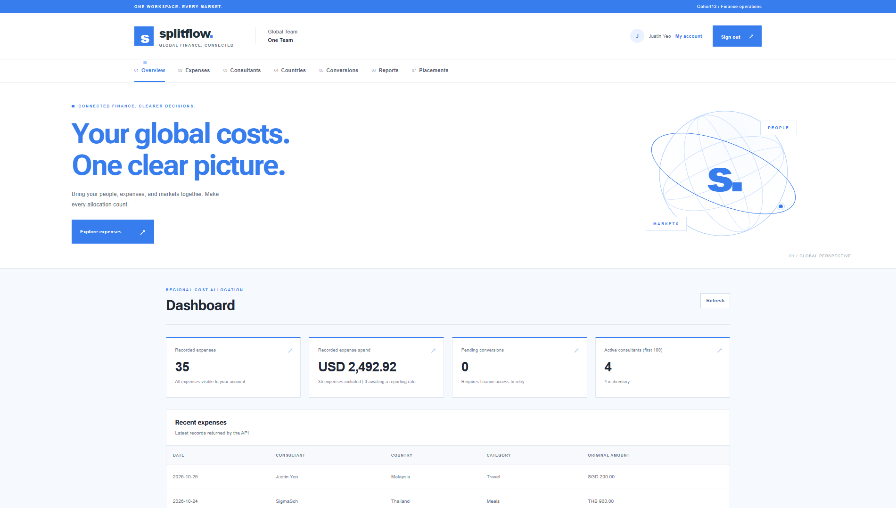

# Splitflow

**Live website:** https://splitflow-finance.vercel.app

**A finance and performance workspace for sales agencies operating across countries.**

Splitflow brings consultant salaries, operating expenses and placement revenue together so agencies can understand individual contribution, compare country performance and report to headquarters in their company's home currency.

## Screenshots

> 

## Core features

- **ROI reporting:** Compare consultant, country and company performance by period.
- **Automatic conversion:** Allocate expenses in regional currencies using historical rates.
- **Headquarters consolidation:** Report revenue and costs in the company's home currency.
- **Consultant management:** Track roles, salaries, employment and country assignments.
- **Expense entry and imports:** Add expenses individually or upload CSV files.
- **Invited access:** Let invited consultants view only their own expenses.
- **Company isolation:** Protect company records with membership-based permissions.

## Explore the pages

| Page | What it helps users do |
|---|---|
| **Dashboard** | Review spending, conversion status and recent expenses at a glance. |
| **Expenses / My expenses** | Manage the company expense ledger and imports, or review personal expenses as a consultant. |
| **Consultants** | Maintain the team, compensation, country assignments and login invitations. |
| **Countries** | Configure regional reporting currencies. |
| **Placements** | Record client revenue, consultant attribution and recognition dates. |
| **Conversions & exceptions** | Review pending historical conversions and retry unavailable rates. |
| **Reports & reconciliation** | Compare ROI and inspect regional allocations and conversion records, with paginated tables. |
| **My account** | View the user profile, select an invited company and manage permitted company settings. |

## How ROI works

```text
Total costs = Operating expenses excluding marked payroll + Accrued base salary
Profit contribution = Recognized revenue - Total costs
ROI (%) = Profit contribution / Total costs x 100
```

Revenue follows its recognition date; operating expenses follow transaction dates. Salary follows effective-dated compensation, employment dates and country assignments, with partial periods prorated by calendar days. Payroll expenses already represented in salary history must be marked to avoid double counting.

Reports identify missing revenue, salary coverage or exchange rates and withhold incomplete profit/ROI. Zero-cost ROI is undefined. Results are live calculations based on recorded costs, rather than closed accounting statements.

## Tech stack

| Layer | Technology |
|---|---|
| Frontend | React 19, JavaScript (JSX), Vite 7 |
| Routing | React Router 7 |
| Styling | CSS, responsive layouts, React Bits VariableProximity heading effect |
| Authentication | Supabase Auth with email/password and Google sign-in |
| Database | Supabase PostgreSQL, row-level security and effective-dated records |
| Backend | Node.js, Express, Zod validation and Supabase JavaScript client |
| API hosting | Railway |
| Currency data | Historical exchange-rate providers with fallback handling |

This repository contains the frontend. The companion backend is maintained in `splitflow-capstone-api`.

## Documentation

- [Product and system architecture](ARCHITECTURE.md)
