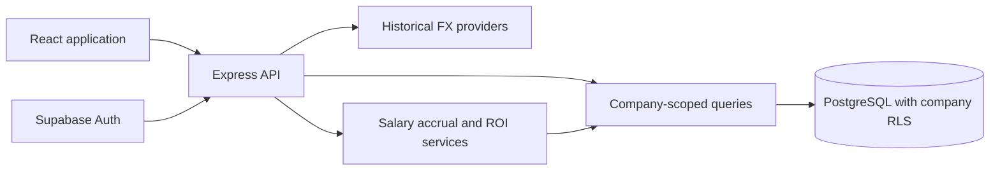

# Splitflow architecture and rollout proposal

Updated: 26 October 2026

## Purpose

Splitflow helps sales agencies compare consultant revenue with operating expenses and base salary costs, measure individual and country ROI, allocate expenses to regional currencies, and consolidate results in the company's home currency for headquarters.

## Implementation status

The three original core gaps are implemented and activated locally: company isolation, salary-inclusive ROI, and configurable home-currency reporting. The user approved the migration, and it was applied as `20261025172908_company_tenant_isolation_salary_reporting`. A follow-up migration, `20261025172936_move_salary_gist_extension_to_extensions`, resolved the new extension-placement warning.

The local API now uses `COMPANY_REPORTING_ENABLED=true`. New installations default to false until migration and isolation checks pass. Cohort13 retains all 35 expenses, four placements and three consultants, with three initial salary-history records. Its home currency remains USD until an administrator changes it under My account.

## Application structure

The frontend handles entry, imports, reconciliation, account settings and report filters. Express validates data, resolves the authenticated company membership, scopes queries, performs conversions and calculates reports. Supabase Auth provides identity. PostgreSQL enforces company ownership and historical salary constraints independently of the UI.

## Company isolation

The proposed schema adds `companies`, `company_memberships` and immutable `company_id` ownership to countries, consultants, assignment histories, expenses, placements, imports and conversions. Composite foreign keys prevent linking records across companies. RLS restricts reads and writes to the authenticated company and membership role. The API also scopes reads/updates and supplies ownership on inserts/upserts.

Profiles remain user-specific; clients cannot edit profile roles, company ownership or memberships. Role checks use company membership rather than user-editable metadata. Each new signup creates a new company and an administrator membership for its founder. Matching company names never imply membership. Existing users retain their roles within their company; this is not global administrator access.

The migration explicitly maps the current single-user dataset to Cohort13's company. It aborts if the existing profile count changes, requiring an explicit ownership mapping instead of guessing. Business data and readable IDs are retained. Country names and import source identifiers become unique within a company.

Exchange rates remain shared market-data cache entries; they contain no consultant or company financial transactions. Existing country-level expense conversion records remain company-owned.

Invitation-based joining, multi-company switching and membership administration are future work. The initial model supports one active company per profile and never automatically joins users based on their email domain or company name.

## Salary and employment history

The proposed `compensation_history` table preserves annual base salary, original currency and effective dates. Consultant inserts and later salary changes create historical records. Updates must use a later salary effective date; overlapping salary intervals are rejected. Clients can read history but cannot rewrite it directly. Existing salaries seed the first interval.

Consultants also have employment start/end dates. Employment dates, rather than the current Active flag, determine historical payroll accrual.

Salary accrual uses:

`Monthly base salary = Annual base salary / 12`

`Accrued salary = Monthly base salary x employed days / calendar days in month`

Accrual stops at the earlier of the reporting end, employment end or today's date in the company timezone. Country transfers divide accrued salary using effective-dated assignments. Salary changes use the historical pay interval for each day. Daily amounts use cumulative cent rounding, preserving totals across transfers and partial periods. Salary segments are translated at their last accrued date using historical FX rates.

Salary accrual is calculated for reporting rather than written as duplicate expense records. Expenses marked as payroll are excluded from ROI operating costs because compensation history supplies the salary cost. CSV imports support optional `is_payroll=true|false`; finance must correctly identify previously imported payroll. Bonuses, employer contributions and benefits require separate operating expense entries until modeled explicitly.

Missing salary coverage produces incomplete rows. Missing employment information produces a report-level warning and suppresses profit/ROI rather than silently inventing zero payroll.

## Currency and reporting

Company settings expose name and headquarters home currency to company administrators. Existing companies default to USD to preserve previous reporting behavior. Settings also return the reporting timezone; this release uses calendar periods, not configurable fiscal calendars.

Expenses retain their original currency and amount. Their regional allocation continues to convert automatically into the attributed country's reporting currency. ROI and headquarters consolidation convert original operating expenses, salary accrual and recognized revenue directly into the company's home currency. They do not compound rounding by converting through a regional amount first.

Reports support country, consultant and headquarters views, monthly/quarterly/yearly aggregation, and consultant filtering. Headquarters consolidation combines the company's countries for each period. Individual ROI combines the consultant's work across countries. Regional expense-allocation reports remain in regional currencies.

`Total costs = Operating expenses excluding marked payroll + Accrued base salaries`

`Profit contribution = Recognized revenue - Total costs`

`ROI (%) = Profit contribution / Total costs x 100`

Period ratios are calculated from period totals, not averaged monthly percentages. Zero-cost ROI remains undefined. Missing salary, revenue or FX rates withhold final profit/ROI. The report displays operating and salary components separately. The separate recorded-expense spending metric remains expense-only and is labeled accordingly.

## Conversion workflow

The current conversion service runs during expense create/update and accepted CSV rows. It persists a pending conversion before external lookup, caches matching rates within an import, and leaves the expense saved when conversion fails. Pending cases support manual retry.

Successful conversions still finalize immediately and lock source amount/currency/date/consultant under existing rules. A durable background worker, scheduled retries and a distinct approval lifecycle are **not implemented** by this change. Reports are provisional calculations and are not locked accounting snapshots. Home-currency changes can change historical report valuations.

## Rollout and verification

1. Review and approve [the database migration](database-proposals/company-salary-reporting.sql). It replaces broad policies and adds company ownership, membership, salary history and payroll classification.
2. Apply it transactionally through the Supabase migration tool, then save the returned migration version in the companion API repository. Do not invent a version or partially apply the file.
3. Run [the rollback-only isolation checks](database-proposals/verify-company-isolation.sql). They verify separate same-name signups, cross-company read denial, cross-company foreign-key rejection and blocked privilege escalation. Test records are rolled back.
4. Run Supabase security advisors and validate the new PostgREST relationships and authenticated read/write paths.
5. Set `COMPANY_REPORTING_ENABLED=true` in the API environment and restart. Confirm Cohort13's data remains present, configure its home currency, and inspect salary/expense/revenue totals for a known month.
6. Verify signup, Google company completion, consultant salary changes, imports, regional conversions, company settings and each report view in a signed-in browser session.

The production frontend build and 47 backend tests pass. Tests cover default and enabled application paths, company query scoping, salary history/proration, leap days, transfers, compensation changes, currency selection, payroll deduplication and period aggregation. Live rollback-only RLS checks passed, including same-name company separation, cross-company denial, privilege-escalation prevention and salary-trigger behavior. Authenticated database reads/updates for Cohort13 passed. API health and readiness return 200; readiness recognizes authenticated-only database access without granting anonymous reads.

Signed-in browser and authenticated HTTP verification remain unperformed. Automatic review rejected creation of persistent temporary test credentials; rollback-only SQL verification was used instead. No test users remain. The existing leaked-password-protection warning is unrelated and unchanged; security advisors report no new warnings from this rollout.

## Further development

After the core rollout: invitation-based membership management; approved shared-cost allocation rules; durable conversion processing and scheduled retries; approval and adjustment workflows; fiscal calendars; immutable report snapshots; exports and audit review screens. These are separate increments, not claims about current implementation.
